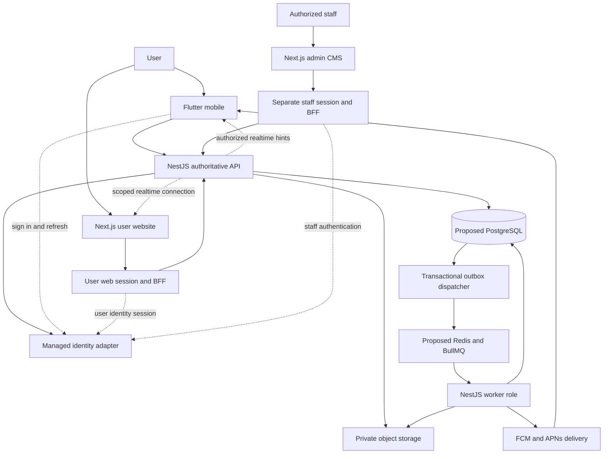
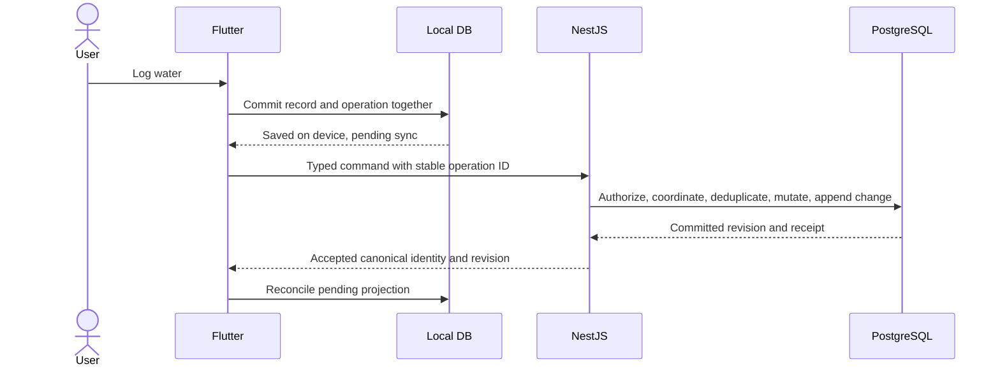

# Your Own — System Architecture

- **Version:** 0.11
- **Status:** Target architecture; local API/mobile foundations exist, full system not implemented
- **Confirmed frameworks:** Flutter mobile, NestJS backend, Next.js user website, separate Next.js admin CMS
- **Product authority:** [PRD.md](../PRD.md)

This is the single end-to-end architecture overview. Read it to understand the complete system; use the linked specifications for implementation detail. A diagram describes a target, not infrastructure already provisioned.

## Contents

- [1. Document map and authority](#1-document-map-and-authority)
- [2. Decisions and constraints](#2-decisions-and-constraints)
- [3. System context](#3-system-context)
- [4. Runtime components](#4-runtime-components)
- [5. Repository and code boundaries](#5-repository-and-code-boundaries)
- [6. Domain boundaries](#6-domain-boundaries)
- [7. Data ownership and consistency](#7-data-ownership-and-consistency)
- [8. Personal capture and synchronization](#8-personal-capture-and-synchronization)
- [9. Money transactions](#9-money-transactions)
- [10. Progress and timer behavior](#10-progress-and-timer-behavior)
- [11. Card preparation and publication](#11-card-preparation-and-publication)
- [12. Social access and revocation](#12-social-access-and-revocation)
- [13. Messaging and notifications](#13-messaging-and-notifications)
- [14. Identity and staff access](#14-identity-and-staff-access)
- [15. Failure handling and operations](#15-failure-handling-and-operations)
- [16. Release dependencies and decision gates](#16-release-dependencies-and-decision-gates)

## 1. Document map and authority

| Document | Owns |
|---|---|
| [PRD.md](../PRD.md) | Product scope, behavior, principles, and global V1 stages |
| [architecture.md](architecture.md) | Whole-system relationships, boundaries, flows, and architecture decision status |
| [schema.md](schema.md) | Proposed logical data model, constraints, indexes, and persistence semantics |
| [security.md](security.md) | Cross-system threat model, identity/access rules, privacy and security controls |
| [testing.md](testing.md) | Verification strategy, shared scenarios, evidence, and release gates |
| [deployment.md](deployment.md) | Environments, process topology, delivery, recovery, and operations |
| [design-system.md](design-system.md) | Standalone Your Own tokens, light/dark themes, component contracts, accessibility, and adaptive layouts |
| [MOBILE_TECH_SPEC.md](../MOBILE_TECH_SPEC.md) | Flutter implementation and mobile platform behavior |
| [BACKEND_TECH_SPEC.md](../BACKEND_TECH_SPEC.md) | NestJS modules, API proposals, jobs, and server requirements |
| [WEB_PRD.md](../WEB_PRD.md) | User website workflows and browser-specific behavior |
| [ADMIN_CMS_PRD.md](../ADMIN_CMS_PRD.md) | Staff workflows, capability boundaries, and optional editorial scope |

Product and platform specifications live directly in `docs/`; these six cross-cutting guides live in `docs/cookbook/`. The design-system guide is self-contained and does not depend on the original visual-inspiration file.

Repository-wide accepted decisions live in `docs/cookbook/decisions/`, starting with [Decision 0001](decisions/0001-scope-and-release-tracks.md). The project owner approves decisions; agents record evidence and keep affected specifications synchronized. App-local decision records reference shared decisions rather than duplicating them.

Product scope changes require a PRD decision. Cross-cutting documents consolidate engineering defaults; feature specifications specialize them, not silently contradict them. Resolve conflicts explicitly and update all affected documents. Proposed tables, endpoints, providers, colors, and numerical limits do not become approved merely by appearing in a second document.

## 2. Decisions and constraints

### Confirmed

- Mobile-first Flutter application with an Android-first limited personal pilot; phone/tablet adaptation, including large iPads, remains required.
- NestJS backend shared by all clients.
- Two separate Next.js applications: user web and internal admin CMS.
- Focus, Read, Intake, Money; generated progress-card sharing and the selected social features.
- Manual Money only, no bank/payment integration; no videos/reels, unrelated posts, or endless feed.
- [Decision 0002](decisions/0002-rounded-icons-and-chart-rendering.md): one comprehensive rounded icon family, ApexCharts for user-web data charts, and native/custom Flutter charts where needed. [Decision 0004](decisions/0004-toolchain-directions-and-icon-family.md) selects **Hugeicons Free Stroke Rounded** and confirms the ApexCharts integration hold pending licensing clarification. Exact pins, distribution notices, coverage and integration evidence remain separate gates.

[Decision 0003](decisions/0003-product-defaults.md) accepts P01–P11 product defaults, including account-required tracking, private/followers-only defaults, English-first Android UI, explicit units, restricted historical Focus edits and locked single-currency/independent savings semantics. This product-default decision did not approve the technical baseline below. Decision 0004 separately accepts lean pnpm and the specified mobile/web directions, with Node 24 LTS/TypeScript 6 candidate direction and an isolated stable Flutter SDK; exact versions and the remaining infrastructure choices are not approved.

[Decision 0010](decisions/0010-conditional-dependency-exceptions.md) conditionally accepts only the three exact tested ESLint peer allowances and the exact Nest-parent Multer override as eligible for a later separately approved baseline. Project-owner accountability, at-most-30-day review, fresh revalidation and safe removal apply; no baseline, final pins, install/execution or scaffolding is approved. It does not resolve notices, targets, omitted libraries or ApexCharts entitlement.

[Decision 0011](decisions/0011-supported-environment-review-order.md) permits M00-T05's [supported-environment review](supported-environments-review.md) before M00-T04 completion, to resolve target-dependent pin questions. T04 remains open/unchecked and paused; no target baseline, device access, infrastructure or executable work is accepted by this task-order adjustment.

[Decision 0012](decisions/0012-local-development-bootstrap.md) subsequently authorizes local workspace/API/mobile setup using installed tools before full M00 completion. The [bootstrap](local-development-bootstrap.md) contains only a health API and Flutter setup shell; no domain service, database, provider or worker exists. Local pins do not select a release baseline, and Next.js apps remain later work.

### Proposed technical baseline

| Concern | Recommendation | Approval/validation needed |
|---|---|---|
| Backend structure | Modular monolith; API and worker roles share code | Module interfaces and workload tests |
| Public API | REST/OpenAPI with generated Dart/TypeScript clients | Contract generation and compatibility spike |
| Main persistence | PostgreSQL + Prisma | Schema, SQL constraints, pooling, migrations |
| Mobile | Riverpod, Drift, Dio, go_router directions accepted in Decision 0004 | Exact Flutter/Dart pair and package pins, encrypted SQLite driver/keys, platform tests |
| Web/admin | App Router/React, TypeScript, Tailwind, TanStack Query, React Hook Form/Zod and owned accessible component directions accepted | Exact pins, underlying primitives (shadcn/ui remains a candidate), browser baseline, session/CSRF and accessibility |
| Workspace | Lean pnpm; separate Flutter SDK pin/application lockfile; no extra orchestrator by default | Manager bootstrap/version, compatible supported graph and installation authorization |
| Identity/storage | Managed services; Supabase candidates | Actual token/session model, storage policies, cost/region |
| Async work | PostgreSQL outbox + BullMQ/Redis | Crash recovery, queue durability, idempotent consumers |
| Realtime/push | Socket.IO and FCM/APNs | Authorization, ticket integration, platform setup |
| Deployment | Persistent NestJS processes; independently deployed web/admin | Hosting, budgets, backups, operating ownership |

No Kubernetes, Kafka, service-per-mode deployment, separate financial database, or second domain backend is required initially. No exact framework/runtime versions or cloud vendor are selected here.

## 3. System context



The Next.js BFFs handle browser sessions, safe proxying, and rendering. They do not own financial/social domain rules. Database and private storage are not directly available to browsers/mobile through an unrestricted provider data API.

## 4. Runtime components

| Component | Responsibilities | Not responsible for |
|---|---|---|
| Flutter | Adaptive UI, local personal records/outbox, timer recovery, device notifications | Granting social access or verifying real bank balances |
| User Next.js | Public pages and authenticated browser UI, session boundary, online-first interactions | Reimplementing the ledger or assuming mobile background/offline guarantees |
| Admin Next.js | Restricted operations, reports, moderation, support, audit views | Unrestricted private-data browsing or direct SQL |
| NestJS API | Identity context, policies, validation, transactions, sync, canonical queries | Per-second timer ticking or expensive image work inside requests |
| PostgreSQL | Domain truth, revisions, receipts, change streams, outbox, durable job state | A cache of data stored only in Redis |
| Worker/dispatcher | Rendering, push, exports, cleanup, retries/rebuilds | Automatically publishing a completed render |
| Redis/BullMQ | Queue execution and coordination where introduced | Sole copy of accepted work, messages, blocks, or finance |
| Private storage | Poster/export/avatar bytes under controlled access | Deciding that an unguessable URL is authorized |
| Managed identity | Identity issuance/recovery under the selected provider | Application roles, ownership, or post audiences |

API/worker are deployment roles from one codebase, not a microservice per feature. Admin can ship before the full user website.

## 5. Repository and code boundaries

Target repository structure: `docs/`, `docs/cookbook/`, `apps/api/` and `apps/mobile/` now exist. Web/admin and shared packages below remain proposed, not scaffolded:

```text
apps/
  mobile/                 Flutter
  api/                    NestJS API and worker entry points
  web/                    User Next.js application
  admin/                  Separate Next.js staff application
packages/
  api-client/             Generated TypeScript contract client, if shared
  web-ui/                 Reviewed shared React primitives, if useful
  design-tokens/          Platform-neutral token source, if adopted
docs/                     Product and platform specifications
  cookbook/               Cross-cutting architecture and engineering guides
    architecture.md
    deployment.md
    design-system.md
    schema.md
    security.md
    testing.md
```

### 5.1 Application and shared-package ownership

| Path | Responsibility | Detailed file map |
|---|---|---|
| `apps/mobile/` | Flutter feature-first app, local projection/outbox, adaptive UI | [Mobile structure](../MOBILE_TECH_SPEC.md#5-proposed-project-structure) |
| `apps/api/` | NestJS HTTP/realtime API, worker roles, domain rules, migrations | [Backend structure](../BACKEND_TECH_SPEC.md#7-proposed-project-structure) |
| `apps/web/` | User Next.js pages/features and separate user session/BFF | [Web structure](../WEB_PRD.md#7-architecture-and-project-boundaries) |
| `apps/admin/` | Staff Next.js pages/features and separate staff session/BFF | [Admin structure](../ADMIN_CMS_PRD.md#9-architecture-and-shared-code-boundaries) |
| `packages/api-client/` | Generated, framework-neutral TypeScript user/operator contract entry points, if shared | Generated from reviewed NestJS OpenAPI; no cookies, global credentials, or domain rules |
| `packages/web-ui/` | Reviewed React primitives, if sharing is useful | No feature screens, evidence loaders, permission engines, or session dependencies |
| `packages/design-tokens/` | Platform-neutral semantic token definitions/adapters, if adopted | Follows [design-system.md](design-system.md); not React widgets imported into Flutter |

- Flutter uses feature-first domain/data/presentation boundaries and a generated or contract-aligned Dart client. It does not import the TypeScript API package.
- NestJS `modules/<domain>/transport/` maps external requests; `application/` coordinates operations; `domain/` owns pure invariants; module `infrastructure/` implements owned repositories. Root `infrastructure/` provides shared provider/database transports. HTTP and worker composition roots reuse services without registering unrelated HTTP listeners/consumers.
- Next.js `src/app/` owns thin route composition, `src/features/` owns product UI and narrow feature adapters, `src/server/` owns server-only session/BFF infrastructure, and `src/components/` owns reusable app-local presentation. Neither Next.js app imports backend services/Prisma to bypass the API.
- Domain migrations live only under `apps/api/prisma/migrations/` if Prisma is adopted. A dedicated least-privilege session store is an infrastructure exception, not another domain data path.
- Shared code flows from apps to explicit package entry points, not from `apps/web` to `apps/admin` or vice versa. The user website imports only the user contract entry; admin operator adapters use the operator entry. Do not create a barrel that mixes privileged server code with browser-safe exports.
- Generated client code must not be edited manually. OpenAPI user/operator artifacts are generated projections of one authoritative backend contract, not two hand-maintained APIs. Browser feature clients call same-origin BFFs; credential-bearing generated clients belong behind server adapters.
- Start app-local and extract genuinely shared primitives when useful; after extraction, update callers/indexes and keep one implementation owner rather than divergent local/package copies. Lean pnpm is the accepted workspace direction; exact manager/runtime/package pins and bootstrap remain unverified.
- Shared truth does not mean identical Flutter/React internals. Portable tokens/contracts need tested platform adapters. Create folders with approved slices, not hundreds of empty placeholders.

The initial API/Flutter [import-boundary implementation](import-boundaries.md) now enforces owned source roots, pure domain/contract imports, explicit cross-feature public entries and composition-only wiring. `HealthModule` owns its controller; the Flutter setup screen lives under its feature presentation layer. These guards do not introduce domain features or replace runtime/privacy/native tests.

### 5.2 Feature-to-application path map

Paths are relative to each app's `src/` unless shown otherwise. They describe responsibility, not files already created. Admin deliberately has no ordinary Money/tracker feature tree.

| Capability | NestJS owner | User web owner | Admin owner |
|---|---|---|---|
| Identity/account | `modules/identity/`, `modules/users/` | `features/auth/`, `onboarding/`, `profile/`, `settings/` | `features/auth/`, minimal `users/`; backend `staff-access/` for operator assurance |
| Today and contribution summaries | `modules/progress/` through mode-owned contracts | `features/today/`, `features/progress/` | No private tracking dashboard |
| Focus / Read / Intake / Money | Corresponding `modules/focus/`, `read/`, `intake/`, `money/` | Corresponding `features/focus/`, `read/`, `intake/`, `money/` | No raw tracker/financial editor |
| Poster/media | `modules/cards/`, `modules/media/` | `features/cards/`, authorized media presentation | Scoped report evidence / eligible job status only |
| Feed/profile interactions | `modules/social/`, authorized `modules/users/` projections | `features/social/`, `features/profile/` | `features/reports/`, `features/moderation/` for permitted review |
| Messaging | `modules/messaging/` | `features/messaging/` | Selected reported evidence only, not DM browsing |
| Notifications/jobs | `modules/notifications/`, `modules/jobs/` | `features/notifications/` | `features/operations/` for safe status/retry |
| Reports/moderation/appeals | `modules/moderation/`, `modules/audit/` | Reporting/blocking UI in `features/social/` | `features/reports/`, `moderation/`, `appeals/` |
| Staff grants/audit | `modules/staff-access/`, `modules/audit/` | No operator feature or contract imports | `features/staff/`, `features/audit/` |
| Export/deletion | `modules/data-lifecycle/` | `features/settings/` | `features/data-requests/`, metadata only |
| Editorial/configuration | Separately approved optional backend modules | Approved public content presentation only | Optional A2 `features/content/`, `configuration/` |

A URL namespace and a filesystem module are not the same thing. `/v1/operator/...` operations stay with their owning domains rather than a giant unrestricted admin service. Next.js route groups such as `(public)` and `(protected)` organize files but neither change URL segments nor grant access.

### 5.3 End-to-end navigation and traceability

Representative code paths are specified in the linked application maps:

| Journey | Page / browser feature | Same-origin BFF | NestJS authority |
|---|---|---|---|
| Record a manual transaction | Web `/app/money`, `features/money/` | `POST /api/bff/money/transactions` | `POST /v1/money/transactions` -> Money application handler and atomic transaction |
| Read a report | Admin `/reports/:reportId`, `features/reports/` | Browser refresh uses the explicit reports BFF; server loader calls NestJS directly | `GET /v1/operator/reports/:id` -> scoped evidence + access audit |
| Apply moderation action | Admin report detail, `features/moderation/` | `POST /api/bff/moderation-actions` | `POST /v1/operator/moderation-actions` -> current grants/assurance + decision/audit |

SSR loaders call server adapters directly, not an HTTP loop through their own BFF. BFF routes enforce sessions/CSRF and map to fixed allowed operations; backend authorization and business transactions remain mandatory. Carry stable operation IDs and revisions through mutations. All listed URLs remain draft contracts until approval/testing.

Each app gets a short `README.md` navigation entry and local `docs/` indexes when scaffolded:

| Index | API | User web | Admin |
|---|---|---|---|
| Ownership | `MODULE_INDEX.md` | `FEATURE_INDEX.md` | `FEATURE_INDEX.md` |
| Request navigation | `ENDPOINT_MAP.md` | `ROUTE_MAP.md` | `ROUTE_MAP.md` |
| Specialized map | `JOB_MAP.md` | `COMPONENT_CATALOG.md` | `CAPABILITY_MAP.md`, `COMPONENT_CATALOG.md` |
| Requirement/evidence | `TRACEABILITY.md` | `TRACEABILITY.md` | `TRACEABILITY.md` |
| Decisions | `decisions/` | `decisions/` | `decisions/` |

Use existing requirement IDs, implementation paths, route/operation IDs, test/evidence paths, and release stage in each traceability row. Statuses are **Planned → In progress → Implemented → Verified**, with actual evidence before Verified. Feature/module READMEs link public contracts and tests. These are navigation indexes, not duplicated PRDs, editable copies of generated API schemas, or repositories of real user data. The initial API/mobile READMEs currently provide their small source/test maps; fuller indexes remain M01-T08 work.

Tests primarily mirror their owned source modules/features; real integration/concurrency and full browser/API journeys have dedicated suites. A route/module/contract move must update its indexes and affected tests in the same change. Naming conventions distinguish `.spec.ts` backend tests and frontend `.test.tsx`/browser `.spec.ts` examples, but exact runners remain subject to the selected stack.

## 6. Domain boundaries

| Domain | Core responsibility |
|---|---|
| Identity/users/staff | Account lifecycle, preferences, trusted staff grants and assurance |
| Focus | Lightweight tasks, session state, one online active session, history |
| Read | Books, ordered progress, completion and reading goals |
| Intake | Separate water/coffee records, effective-dated water targets |
| Money | Manual accounts, exact transactions/postings, budgets, independent savings planning |
| Progress | Private summaries and contribution projections; no universal life score |
| Sync | Typed personal commands, receipts, ordered changes, snapshots, tombstones |
| Cards/media | Allowlisted snapshots, exact preview, explicit publication, private bytes |
| Social | Graph, finite chronological feed, reactions/comments, source-aware reposts |
| Messaging | Pair/request policy, durable sends, ordered history, unread state |
| Notifications/jobs | Durable execution, eligibility checks, safe delivery |
| Moderation/lifecycle | Scoped report evidence, audit, export/deletion and retention |

Today composes narrow mode-summary contracts. Public profiles return deliberately published fields, not a reused private dashboard DTO. An optional editorial CMS is a separate approved extension, not an unrestricted content/table editor.

## 7. Data ownership and consistency

| Data | Authority | Client copy |
|---|---|---|
| Accepted tracking records | PostgreSQL | Flutter local projection; web authorized query state |
| Unsynced mobile action | Durable per-user local record + outbox | Explicitly pending, not server-accepted |
| Money balances | Accepted exact postings/approved projection | Pending local overlay clearly identified |
| Audience/blocks/staff grant | Current authoritative server state | Hints only; never permanent permission |
| Published poster | Versioned canonical snapshot | Authorized preview/image, not live raw tracker |
| Messages | Durable server rows and conversation sequence | Deduplicated participant cache/drafts |
| Async requirement | Committed outbox/job state | Preparing/failed/ready status |

A domain write, revision, required personal change entry, receipt, and outbox entry commit together. No external push/storage/identity HTTP call belongs inside that transaction.

## 8. Personal capture and synchronization



If the response is lost, retry the same operation; do not create another semantic action. Use at-least-once delivery with idempotent effects, not an exactly-once network claim.

Proposed personal change ordering locks an owner stream-state row in the mutation transaction. A global sequence allocated before commit is not sufficient: a late lower-ID commit could be skipped by a cursor. Bootstrap chunks belong to a consistent snapshot generation and watermark. Expired cursors require safe resync while retaining pending changes.

Independent new logs merge by stable IDs. Concurrent edits to Money, book progress, plans, or active sessions require explicit revision/conflict handling. Tombstones prevent stale resurrection. The proposed 90-day offline horizon remains unapproved and is not a universal retention policy.

Web is proposed online-first: mutations use the same handlers/change stream, without promising a Flutter-equivalent local database/outbox. A browser-unknown outcome preserves operation identity; missing receipt status does not prove an in-flight request cannot still commit.

## 9. Money transactions

A manual transaction uses a header and account postings. Income credits one account, expense debits one, and transfer records equal opposite postings in one transaction. Openings/adjustments are distinct from income/expenses.

- Minor-unit integers remain exact through database, API decimal strings, clients, export, and rendering.
- Same-owner/currency constraints and deterministic coordination protect coupled edits.
- Never split a transfer into two independent client operations.
- Cached balances, if introduced, reconcile against accepted postings.
- Savings-goal entries are an independent planning ledger: they do not move funds, reserve balances, or create new assets.
- Plans describe allocations; they do not create expenses or completed savings.
- Corrections/deletions are legitimate tracking operations, not automatically prohibited banking behavior.

Detailed constraints and deletion semantics are in [schema.md](schema.md).

## 10. Progress and timer behavior

The proposed overall contribution intensity counts distinct modes with qualifying activity, not pages + currency + drinks + minutes. More spending/coffee/water is not inherently better. Social actions do not improve personal contributions.

Timers persist timing segments/state; display ticks are not the clock of record. Pauses/breaks are excluded, countdowns stop at their intended end, and interrupted/overlapping sessions are resolved without silently doubling time. Online active-session coordination is server-side; mobile reconstructs after background/restart. Browser closure/throttling prevents equivalent alert guarantees.

Preserve intended historical activity dates and effective-dated goals; timezone changes must not reclassify all history. Handle DST rather than assuming every local day is 24 hours.

## 11. Card preparation and publication

1. User selects supported sources, period, fields, caption, audience, and template.
2. Mobile may preview/export its own private local draft; this is not server publication.
3. For publishing, synchronize sources and prepare an owner-only canonical snapshot.
4. Worker renders only selected allowlisted data into bounded private media.
5. User sees the exact canonical preview and explicitly confirms that version.
6. API rechecks current account/source/audience eligibility and commits publication.

Rendering completion never publishes automatically. Later source changes do not silently modify published snapshots. Regeneration needs renewed preview/confirmation. Hidden finance/task fields must be absent from snapshot JSON, accessibility text, metadata, and images—not merely hidden with styling.

## 12. Social access and revocation

Effective access considers account status/visibility, persisted audience/publication generation, current follows, blocks, moderation, and source eligibility.

A proposed generation scheme preserves follower-only history across public → private → public transitions; details are in [schema.md](schema.md). Current account state restricts reads immediately, without waiting for a cache purge or mass update.

- Feed is finite and chronological; engagement does not reorder it.
- Reposts are references eligible only while the source is public; a private link/DM cannot widen source access.
- Private media reauthorizes at delivery; signed URLs that remain valid until expiry are not instantaneous revocation.
- SSR/RSC/metadata/image caches must not expose private content.
- Current policies govern cache hits and workers as well as new API reads.
- Previously delivered responses, screenshots, external previews, and exports cannot be recalled universally.

## 13. Messaging and notifications

Proposed canonical send path: idempotent HTTP mutation, then Socket.IO hints. Lock/coordinate the user pair and conversation, re-read contact/block permissions under that coordination, allocate a conversation sequence, persist once, and commit outbox work before acknowledgement.

Sockets may disconnect/duplicate/miss events; history/cursors recover gaps. A browser BFF can obtain a short-lived scoped connection ticket instead of exposing a long-lived provider credential. A connection ticket must not authorize general REST or staff actions.

Device-local focus/water alerts are separate from server social/DM push. Push jobs recheck permission, preferences, quiet hours, token ownership, and source availability. Generic previews omit sensitive values. Provider uncertainty means exactly-once lock-screen delivery is not promised.

## 14. Identity and staff access

- Mobile stores credentials through a validated secure SDK integration; adding a storage package alone does not secure SDK persistence.
- Web/admin use proposed separate opaque Secure/HttpOnly/host-only session cookies and allowlisted BFFs; CSRF/Origin protection remains necessary.
- NestJS verifies trusted identity, active application lifecycle, ownership, and policy.
- Staff endpoints additionally require current grants/scopes, MFA, and fresh assurance where required. A normal user token or browser `isAdmin` flag is insufficient.
- Admin operates on minimal account data and case-scoped evidence, not unrestricted trackers/private messages.
- Logout/account switch clears the correct session-scoped data; unsynced mobile changes require an explicit handling path.

[security.md](security.md) defines the trust boundaries and release controls.

## 15. Failure handling and operations

| Failure | Required behavior |
|---|---|
| Personal network loss | Mobile retains durable pending changes; browser reports uncertain/unsaved state truthfully |
| API commit response lost | Retry same operation; no duplicate domain effect |
| Redis/queue outage | Retain committed outbox work; expose pending/degraded state |
| Worker crash | Retry eligible idempotent work; do not republish or double-send domain events |
| Stale revision | Preserve input and offer conflict resolution |
| Permission changed | Deny new access, clear known-revoked surfaces, recheck queued work |
| Database unavailable | No fake successful save; role-appropriate readiness/degradation |
| Restore from backup | Reconcile jobs/media and post-backup lifecycle/revocation knowledge before traffic |

Use one API instance initially and separate workers when workloads require them. Scale queries/indexes, bounded jobs, and replica/pool budgets before adding infrastructure. Privacy decisions must not rely on stale replicas.

See [testing.md](testing.md) for proof requirements and [deployment.md](deployment.md) for rollout, backup, incident, and recovery plans.

## 16. Release dependencies and decision gates

The owner accepted these stage priorities in [Decision 0001](decisions/0001-scope-and-release-tracks.md). Approval of sequencing is not authorization to scaffold, deploy or bypass validation.

- Mobile/backend V1-A: reliable private tracking and data controls, followed by the gated Android-first limited pilot. iPhone/iPad remain required targets with independent native evidence.
- V1-B: social publication requires admin A0 moderation/safety readiness.
- V1-C: reposts and durable messaging complete intended social V1.
- User web W0–W3 is a separate rollout; mobile launch does not imply immediate browser parity.
- Admin A1 operations expands as needed; A2 editorial/configuration is optional.

Before scaffolding, approve supporting packages, API contracts, schema/locks, provider/session integration, encrypted mobile persistence, browser/OS targets, and deployment baseline. Before public social launch, approve retention/age/region policies, moderation ownership, staff assurance, revocable media, and recovery evidence.

No component is ready merely because this overview has been written. Implementation, verification, and operating ownership remain separate work.
