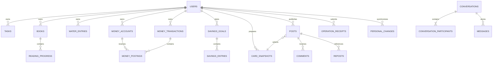

# Your Own — Proposed Data Schema

- **Version:** 0.4
- **Status:** Logical design for review, not an executable Prisma schema or applied migration
- **Related:** [Architecture](architecture.md) · [Backend](../BACKEND_TECH_SPEC.md) · [Security](security.md) · [Testing](testing.md)

PostgreSQL/Prisma are accepted directions under [Decision 0013](decisions/0013-provider-and-session-directions.md), not installed packages or an accepted physical schema. This document makes the proposed relational model concrete enough to review; exact names, types, indexes, physical migrations, retention, identity/session details and provider integration still require approval and validation.

## Contents

- [1. Storage boundaries and conventions](#1-storage-boundaries-and-conventions)
- [2. Relationship overview](#2-relationship-overview)
- [3. Identity, preferences, and staff](#3-identity-preferences-and-staff)
- [4. Focus](#4-focus)
- [5. Reading](#5-reading)
- [6. Intake](#6-intake)
- [7. Money](#7-money)
- [8. Cards, posts, and media](#8-cards-posts-and-media)
- [9. Social relationships](#9-social-relationships)
- [10. Conversations and messages](#10-conversations-and-messages)
- [11. Synchronization and operations](#11-synchronization-and-operations)
- [12. Reports, lifecycle, and optional content](#12-reports-lifecycle-and-optional-content)
- [13. Indexes and transactional invariants](#13-indexes-and-transactional-invariants)
- [14. Flutter local projection](#14-flutter-local-projection)
- [15. Migration and approval gates](#15-migration-and-approval-gates)

## 1. Storage boundaries and conventions

### Stores

| Store | Data | Boundary |
|---|---|---|
| Application PostgreSQL | Accepted domain rows, receipts, changes, outbox, policies | API/worker roles only; restricted application namespace/exposure |
| Nest-owned identity integration | Credential/session/MFA/recovery state for the eventual selected maintained integration | One backend migration/identity authority, no client password stores; exact schema/policies pending |
| External identity provider, only if later adopted | External credentials/issuer state | Provider-owned namespaces are not edited by application migrations; not the current default under Decision 0016 |
| Private object storage | Poster/export/avatar bytes | Metadata in DB; current-context authorized delivery |
| Flutter SQLite/Drift | Per-user personal projection, drafts, outbox, timer state | Not the cloud schema copied verbatim; encryption driver pending validation |
| Browser session store | Opaque sessions and protected provider credentials | Separate web/admin scopes, least-privilege adapter |
| Redis, if selected | Queue execution, coordination, limiter/ticket state | Not sole domain or accepted-work persistence |

### Notation and shared fields

`?` means nullable; `FK` means a real foreign key unless explicitly described as a typed polymorphic reference. Table inventories omit repetitive base columns.

Personal mutable records generally include `id UUID PK`, `owner_id UUID FK users`, `version INTEGER >= 1`, `created_at`, `updated_at`, and `deleted_at?`. Child rows may be versioned through their aggregate instead of independently. Creates use expected version 0 at the API boundary; updates compare the current aggregate revision atomically.

- Timestamps: UTC instants; occurrence context also carries intended `activity_local_date DATE` and IANA `activity_time_zone` where needed.
- Date-only records have explicit semantics, not an invented midnight timestamp.
- Identifiers/times supplied by clients remain validated self-reported input; actor/owner is derived from verified identity.
- BIGINT amounts/sequences serialize as decimal strings; cursors are opaque. No JavaScript floating-point ledger values.
- Use composite ownership FKs, for example `(owner_id, account_id)` → `(owner_id, id)`, where practical, with matching unique keys.
- Soft deletion does not replace retention/purge. Do not apply blanket cascading deletion to sources with published snapshots, messages, or audit references.

## 2. Relationship overview

This is an aggregate relationship map, not a complete SQL diagram. In particular, a conversation has exactly two participants in V1; ER notation alone does not enforce that invariant.

## 3. Identity, preferences, and staff

| Table | Key fields | Rules |
|---|---|---|
| `users` | `id`, normalized username, display name, bio?, avatar ID?, lifecycle status, account visibility, `publication_epoch BIGINT` | Username unique under approved normalization; lifecycle and visibility independent |
| `external_identities`, only if an external issuer is later adopted | user FK, issuer, subject, provider metadata needed for operation | Unique issuer+subject; never merge users solely by email |
| `user_preferences` | user PK/FK, timezone, locale, enabled modes, unit choices, hide-amounts, base currency? | Typed bounded settings; currency cannot relabel existing Money records |
| `staff_grants` | staff user FK, role/capability scope, status, grantor, valid period, revision | Only privileged workflow changes these; no client `isAdmin` field |
| `staff_roles` / `staff_role_capabilities` | role key and approved capability codes | Server-owned capability allowlist, no arbitrary executable policy strings |
| `staff_session_contexts`, if needed | trusted identity/session reference, assurance, authentication time, expiry/revocation | Required only if the selected provider/session model needs application state; never trust browser-supplied assurance |
| `deleted_identity_markers` | minimal protected identity reference/digest, validity/retention metadata | Prevent stale-token bootstrap resurrection; exact minimization/retention requires approval |

Browser sessions are a separate infrastructure model: session digest/identifier, realm (`WEB`/`ADMIN`), subject, protected credential reference, expiry, rotation/revocation. Never store plaintext session secrets in audit rows. Select encryption/key/session-store implementation with the reviewed maintained identity integration.

[Decision 0021's design review](authentication-transaction-review.md) corrects the historical unconditional provider-owned assumption under Decision 0016. It proposes a private account credential generation, stable revocable logical grants and explicit session/family bindings, separate from publication epoch and rotating token digests. These are review concepts, not approved physical tables/claims. Root-client stores, independent nested transactions or a route-level transaction wrapper do not establish atomic reset/account/session changes; shared typed unit-of-work and rollback/issuance proofs remain required.

### Proposed publication epoch behavior

- Initial private account has epoch 0; initial public publication context uses a positive epoch.
- Every private → public transition advances the user's epoch transactionally.
- A public post records the current epoch when explicitly published/widened.
- Normal social reads first require an eligible published, nondeleted/nonremoved post and available account; audience rules do not override lifecycle or moderation denial.
- Effective public access additionally requires public author visibility, public post audience, matching current epoch, and no applicable restriction/block.
- If public access fails only because of private visibility or an old publication generation, cap the audience at current approved followers. Still apply all lifecycle/block/moderation checks; a denial is not a fallback permission.
- Public → private immediately restricts reads using the account row. Returning public does not revive old public generations.

This is a proposal to avoid unsafe asynchronous mass audience updates. Publication/widening and account transitions need tested transaction coordination and revision checks.

## 4. Focus

| Table | Key fields | Rules |
|---|---|---|
| `focus_labels` | owner, name, archived state | Work/Study/Personal can be owner-scoped defaults |
| `tasks` | owner, title, note?, label FK?, due date?, `planned_for_date?`, status, completion instant/date? | Today placement independent of due date; repeated completion is not another achievement |
| `focus_sessions` | owner, task FK?, label FK?, timer kind, planned duration?, status, focused duration, occurrence context, conflict state | Focus time excludes pauses/breaks; task deletion preserves valid duration/history |
| `focus_segments` | session FK, start/end instants, segment ordering/type | Valid ordered intervals; duration validated/derived, not blindly accepted totals |
| `active_focus_slots` | owner PK, session FK, version, timing/coordination metadata | One authoritative online slot; recover abandonment without inventing completed time |
| `focus_goals` | owner, metric/target, applicable weekdays, effective date | Optional; history uses effective target context |

Decision 0003 permits task/label/private-note correction and deletion, but no manual historical session creation or duration edits. Runtime/persistence reconciliation is still a contract gate, not permission for arbitrary history edits.

Break phase is distinct from focused work. Device timer state and optional break UI do not become completed focus minutes. Session finalization updates history/projections and releases coordination atomically. Unresolved offline overlap must not count twice.

## 5. Reading

| Table | Key fields | Rules |
|---|---|---|
| `books` | owner, title, author?, total pages?, shelf status, start/finish dates?, private note? | No required catalog; unknown total remains null |
| `reading_progress` | owner/book FKs, current page, activity context, deterministic ordering metadata | Edit under expected book revision; page bounds and ordered history validated |
| `reading_goals` | owner, metric, target, period/schedule, effective date | Approved weekly reading-days/yearly books metrics; no universal activity score |

A page position is not a trusted pages-read delta. Resolve effective ordering using recorded activity context and a stable tie-breaker; calculate valid deltas server-side. Corrections/backdating revalidate affected history, not only the edited row. Concurrent updates from the same book base revision conflict rather than adding both deltas.

Finish is an explicit book transition. Multiple reading cycles per book are outside V1; do not quietly add a reread schema/workflow now.

## 6. Intake

| Table | Key fields | Rules |
|---|---|---|
| `water_entries` | owner, `amount_ml`, activity context, source label? | Positive canonical quantity; edits/deletions recalculate day |
| `water_targets` | owner, effective date, `target_ml?`, revision | Unique effective date per owner; null may represent disabled goal if approved |
| `coffee_entries` | owner, kind (`CUP`/`SHOT`), quantity, activity context, note? | Separate measures, positive count; fractional-count support remains a decision |

Integer milliliters remain the proposed canonical representation. [Decision 0003](decisions/0003-product-defaults.md) accepts mL as the default and optional US fluid ounces (not Imperial); approve exact one-time conversion rounding/precision before implementation. Do not repeatedly round stored totals through display conversions. Coffee does not count toward the water goal; exceeding a water target does not imply higher achievement.

## 7. Money

The owner-approved product semantics are a single user-selected base currency locked after monetary records exist, amount-based monthly budgets and an independent manual savings ledger (Decision 0003). The schema and transaction constraints below remain implementation proposals requiring validation; never silently relabel historical amounts or add a destructive currency-reset workaround.

### Tables

| Table | Key fields | Rules |
|---|---|---|
| `money_accounts` | owner, name, kind, currency, archived state | Same approved base currency in V1; references preserve history |
| `money_categories` | owner, name, income/expense kind, archived state | Defaults copied/scoped under approved catalog policy |
| `money_transactions` | owner, type, `input_amount_minor BIGINT?`, currency, category?, note?, activity context | Positive input for income/expense/transfer; header is one logical mutation; accepted corrections allowed |
| `money_postings` | owner, transaction/account FKs, signed `amount_minor BIGINT`, posting role | Ownership/currency consistent; no detached half-transfer |
| `finance_plans` | owner, month, `planned_income_minor BIGINT?`, currency, version | Unique owner/month; nonnegative planned income if set |
| `plan_allocations` | plan/owner FKs, kind, expense category? or savings goal?, `amount_minor BIGINT` | Nonnegative allocations; expense versus savings distinct; conditional required fields |
| `plan_reviews` | owner/plan FKs, reviewed activity date/instant | Explicit event, not a screen-view side effect |
| `savings_goals` | owner, name, `target_minor BIGINT`, currency, target date? | Positive target; not added to account assets |
| `savings_entries` | owner/goal FKs, direction, positive `amount_minor BIGINT`, activity context | Contributions/withdrawals affect goal progress only |

### Posting invariants

| Transaction type | Required postings | Income/expense report |
|---|---|---|
| Opening | One explicit signed opening posting; zero permitted for a new empty account | Excluded |
| Income | One positive posting | Income |
| Expense | One negative posting | Expense |
| Transfer | Two opposite equal postings to distinct accounts | Excluded |
| Adjustment | Explicit signed reconciliation posting | Separate adjustment category |

- No second opening-balance field is added again during aggregation.
- Transfer header/postings, receipt, change entry, and required outbox work commit atomically.
- Cross-row posting count/equality is not proven by a simple per-row CHECK. Enforce via transaction service plus reviewed SQL safeguards where appropriate.
- Foreign keys/ownership constraints prevent another user's account/category reference.
- All arithmetic, including aggregates, must remain exact and range checked. PostgreSQL aggregate NUMERIC results must not be coerced through JavaScript Number.
- Insufficient recorded balance may warn; negative recorded balances are not automatically prohibited.
- Define empty-account deletion around meaningful activity/references, not an automatic opening row that makes every account undeletable.
- Archive accounts/categories used by retained history; hard purge is a separate lifecycle operation.

### Plans and goals

Expense allocation requires an expense category. Savings allocation optionally references an owned goal or an approved general-savings bucket. Enforce duplicate-allocation policy with appropriate conditional uniqueness; category/goal IDs are not interchangeable.

Plan amounts do not create ledger entries. Goal contributions do not create expenses/transfers/assets or verify reserved funds. Concurrent goal edits/withdrawals and history corrections must validate affected goal balances, including nonnegative progression under the approved ordering policy.

## 8. Cards, posts, and media

| Table | Key fields | Rules |
|---|---|---|
| `card_drafts` | owner, supported kind, template/version, desired audience, preparation status, source revisions | Owner-only; ready/rendered is not published |
| `card_source_refs` | draft FK, owner, source kind/ID/revision | Typed polymorphic reference; service validates type/ownership; use typed joins where SQL FKs are required |
| `card_snapshots` | owner/draft FK, schema/template version, allowlisted JSON payload, accessible text, checksum | Immutable prepared version; no whole private domain objects |
| `media_objects` | owner, purpose, storage key, type, size, checksum, validation/lifecycle state | Private bytes; keys are not permissions |
| `card_media` | snapshot/media FKs, render variant/version | Bound image dimensions; same-owner/context checks |
| `posts` | author FK, current snapshot FK, caption?, audience, publication epoch, published time, edit/moderation/deletion state | Explicit publication; current effective access evaluated on reads |
| `post_snapshot_history` | post/snapshot FKs, selected time/reason | Explicit regeneration history; retention approved |

JSONB does not mean arbitrary JSON from the client. Versioned allowlists exclude unselected amounts, notes, balances, names, and raw source rows from public payloads/metadata.

A draft/media object is owner-only unless a currently eligible published post grants access. Old snapshot versions do not remain public through a media ID. Source correction/deletion warns about existing snapshots; it does not silently alter a post or cascade-delete every snapshot. Public-post deletion invalidates in-app references; external copies cannot be recalled.

## 9. Social relationships

| Table | Key fields | Rules |
|---|---|---|
| `follows` | follower/followed user FKs, request/accepted status, timestamps, revision | Unique directed pair; no self-follow |
| `blocks` | blocker/blocked FKs, timestamp | Unique directed pair; effective contact restriction applies both ways |
| `interaction_pairs` | normalized low/high user FKs, coordination version | Proposed canonical pair coordination for block/contact races; low < high |
| `post_likes` | actor/post FKs, accepted time | Unique actor/post; desired-state writes, current source policy |
| `comments` | author/post FKs, parent comment?, body, edited/deleted/moderated state | Parent same post; one reply level only |
| `reposts` | actor/source post FKs, repost time, active/removal state | Unique active actor/source; never detached copy |

Block removes relevant follows/requests; unblock does not restore them automatically. Repost eligibility requires a currently public source/account; readable original access alone is insufficient. Cached engagement counts cannot become an access grant.

## 10. Conversations and messages

| Table | Key fields | Rules |
|---|---|---|
| `conversations` | normalized pair FK/unique key, status, next sequence, version | Exactly one V1 pair conversation; not a group model |
| `conversation_participants` | conversation/user composite PK, read cursor, hidden state/cutoff | Exactly two distinct allowed participants; own unread/hiding only |
| `conversation_requests` | conversation, initiator/recipient, status, decision time | Recipient settings/current blocks govern initiation and acceptance |
| `messages` | conversation/sender FKs, client message ID, server sequence, kind, text? or post reference?, moderation state | Unique sender/client ID; unique conversation/sequence; one valid payload kind |
| `message_hidden_for` | message/user composite PK, hidden time | User must be participant; does not delete other participant's copy |

Use a composite message-sender FK to the conversation's participant key where practical. Enforce that the two participants are exactly the normalized pair members; a simple user FK or row count alone does not prove that.

Coordinate pair/conversation writes before re-reading current contact policy. Allocate sequence inside the accepted transaction. Duplicate sends do not increment unread again. Card references do not carry permission or a permanently copied image. Large sequences use string serialization.

Read/hide cursors are not public read receipts. Exact behavior when new messages arrive after hiding a conversation and final delivered-message deletion/retention remain explicit policy decisions.

## 11. Synchronization and operations

| Table | Key fields | Rules |
|---|---|---|
| `owner_sync_states` | owner PK, committed position, protocol/retention metadata | Allocate position under owner coordination inside mutation transaction |
| `personal_changes` | owner, position, entity kind/ID/version, change kind, committed time | Unique owner/position; tombstones minimal; no unrelated-owner rows |
| `operation_receipts` | actor, operation ID, command type/scope, normalized payload digest, safe outcome/ref/revision, expiry | Proposed unique actor/operation namespace; different payload reuse conflicts |
| `sync_snapshots` / `sync_snapshot_chunks` | owner, immutable generation, watermark, expiry/status, protected chunk refs | Consistent capture; live-table pagination is not an immutable bootstrap |
| `outbox_events` | event ID/type, aggregate ref/version, required work refs, lease/status/attempt metadata | Insert with domain commit; sensitive payload copies minimized |
| `job_records` | event ID, category, owner/context, status/attempts/result ref | Durable execution state; queue is not the only copy |
| `daily_activity_projections` | owner/date/rule version, mode flags, bounded metrics, source freshness | Rebuildable, private; no unnecessary financial detail in a calendar |
| `push_installations` | owner, installation, protected provider token, active/rotation metadata | Avoid cross-account token ownership leakage |
| `notification_events` / `notification_deliveries` | recipient/source refs, safe type, read state, channel/attempt status | Dedupe inbox; reauthorize source at delivery |

### Stream/receipt semantics

- Owner stream positions must be commit-safe; global sequence allocation alone is not proof of commit order.
- Direct REST and website writes participate in the same personal stream.
- Change rows may reference canonical current projections instead of copying sensitive histories, but the response must expose the actual returned version and support coalescing/deduplication correctly.
- Never label later data as an exact historical version or advance a cursor past omitted eligible changes.
- Receipt lookup is actor-authorized/minimal; unknown does not prove a still-running request failed.
- Replays recheck current lifecycle/access before returning a result; no stale sensitive response cache.
- After the approved horizon, force safe rebootstrap/rebase; never blindly replay old writes after dedupe/tombstone knowledge expires.

## 12. Reports, lifecycle, and optional content

| Table | Key fields | Rules |
|---|---|---|
| `reports` | reporter FK?, target kind/ref, category, status, assigned staff?, revision | Purpose-limited submission; bounded context |
| `report_evidence` | report FK, protected snapshot/media ref, evidence type, retention metadata | Case-scoped access; not general DM/finance browsing |
| `moderation_actions` / `appeals` | case/target refs, actor/grant context, code/reason, outcome, timestamps | Accepted action idempotent; history preserved across appeal |
| `audit_events` | actor/context, target ref, action/result, safe change metadata | Append-only at application boundary; no credentials/raw evidence copies |
| `export_requests` | owner, requested scope, job/status, private result ref/expiry | Operator status is not permission to download the export |
| `deletion_requests` | owner/minimal lifecycle ref, status, phase/retry metadata | Deny rebootstrap/republication and purge all relevant copies |
| `retention_exceptions` | justified scope/reason, approval, expiry | Restricted; not a blanket keep-everything flag |

Optional A2 editorial/configuration tables require separate approval. If adopted, content documents/versions/reviews/publications use constrained schemas and named policy ownership; they are not arbitrary executable JSON or direct edits to users' records.

## 13. Indexes and transactional invariants

Start from actual access patterns, then verify EXPLAIN plans and load tests:
- Personal records: `(owner_id, activity_local_date, id)` or appropriate timestamp; book/account FK indexes.
- Ownership composites for child references; unique owner/month plans and owner/effective-date targets.
- Feed candidates: author/published time/ID and actor/repost time/ID; graph/status lookup indexes.
- Messages: unique conversation/sequence and sender/client-message ID; participant/user lookup.
- Sync: owner/position, actor/operation ID, snapshot owner/status/expiry.
- Outbox/jobs: claimable state/available time/lease expiry.
- Moderation: status/assignment/created time; protected audit target/actor/time indexes.

Critical cross-row invariants require transactions and tested coordination, not optimistic UI or ORM types. Define a consistent lock order for personal stream/aggregates, pair/conversation changes, publication/lifecycle transitions, and staff changes. Any workflow crossing categories needs an explicit deadlock/race review.

Do not route policy decisions to a lagging read replica without a consistency design. Indexes and projections never replace ownership predicates.

## 14. Flutter local projection

Local storage has its own versioned schema, including server identity/revision, local pending/conflict metadata, durable operation outbox, synchronization cursor, drafts, and active timer state.

Write a personal record and its queued command in one SQLite transaction. Reconcile the server base with remaining pending changes; do not overwrite unsynced work with a remote snapshot. Transfer postings remain coupled locally too.

Use a per-user database or equivalently tested isolation. Driver encryption, credential/key management, backup exclusions, and key-loss behavior must be validated before real sensitive data. Do not assume PostgreSQL migrations map directly to Drift migrations or old app databases.

## 15. Migration and approval gates

1. Approve domain semantics, types/ranges, ownership constraints, polymorphic reference strategy, and epoch model.
2. Validate provider namespace/RLS/grants, Prisma SQL gaps, pooling, and exact JSON generation.
3. Implement expand/migrate/contract changes; test old app compatibility and pending mobile outbox upgrades.
4. Add concurrency tests for transfers, goal withdrawals, book revisions, active slots, cursor ordering, block-versus-send, and role revocation.
5. Approve retention across live rows, snapshots, change logs, receipts, queue refs, media, reports, sessions, and backups.
6. Generate actual migrations only after review; no executable SQL/Prisma schema, migrations, or database have been created by this document.
